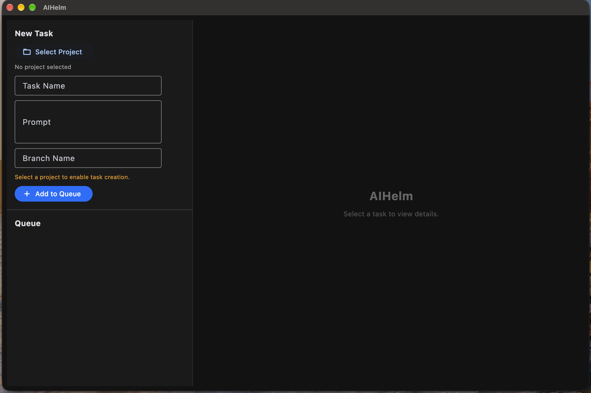

> **Status — October 2026.** Built earlier this year as a local orchestrator for
> AI coding assistants, when the available tools did not handle queued execution
> across Git branches or automatic resumption after a rate limit. Several of those
> capabilities now ship with the assistants themselves. Kept here as a working
> reference for the design; not under active development.



# AIHelm

Local desktop orchestrator for AI code assistants. Queue prompts, let the AI work autonomously, and review the results when you're ready.

## The Problem

Working with local AI code assistants (like `claude-code`) is synchronous and fragile. If the AI hits a token rate limit, it stops — and you have to remember to come back hours later to restart it. That kills overnight runs, breaks focus during meetings, and wastes the AI's potential to work unattended.

## Design

1. **Queue tasks** — Write multiple prompts, assign a Git branch to each, and add them to a queue.
2. **Autonomous execution** — AIHelm creates the branch, runs the AI CLI, and captures output in the background.
3. **Rate limit recovery** — When the AI hits a token limit, AIHelm detects it, pauses the queue, and automatically resumes at a scheduled time (e.g., 1:00 PM or "in 3 hours").
4. **Visual review** — When tasks finish, you review the code diffs in-app and approve or reject each one before committing.

**Implemented:** step 1 — the task queue (create, edit, delete, JSON persistence), workspace selection, and the Flet desktop UI, with 115 unit and BDD tests. Steps 2–4 are specified in `specs/` and the domain layer but not built.

## Quick Start

### Prerequisites

- Python 3.11+
- [Git](https://git-scm.com/) installed and available in PATH
- [claude-code](https://docs.anthropic.com/en/docs/claude-code) (or equivalent AI CLI) installed and authenticated

### Installation

```bash
git clone https://github.com/aspicas/aihelm.git
cd aihelm
python3 -m venv .venv       # Windows: python -m venv .venv
source .venv/bin/activate   # Windows: .venv\Scripts\activate
pip install -e ".[dev]"
```

### Run

```bash
python -m aihelm
```

The first launch downloads the Flet desktop runtime (one-time, needs network).

### Run Tests

```bash
pytest                       # all tests
pytest tests/unit/           # unit tests only
pytest tests/integration/    # integration tests
pytest tests/bdd/            # BDD scenarios
```

## Architecture

Clean Architecture with 4 layers. Dependencies flow inward:

```
UI  ->  Services  ->  Domain (ports)  <-  Infra
```

| Layer | Path | Responsibility |
|-------|------|----------------|
| **Domain** | `src/aihelm/domain/` | Pure models and abstract port interfaces. Zero dependencies. |
| **Services** | `src/aihelm/services/` | Application use cases: queue management, worker orchestration, rate limit handling. |
| **Infra** | `src/aihelm/infra/` | Concrete implementations: JSON persistence, Git CLI, subprocess wrapper. |
| **UI** | `src/aihelm/ui/` | Flet desktop interface: task queue panel, live console, diff reviewer. |
| **Specs** | `specs/` | Source of truth (SDD): contracts, data schemas, business rules. |

Each section has its own `README.md` with dependency rules and interaction guidelines.

## Tech Stack

| Component | Technology |
|-----------|------------|
| Language | Python 3.11+ |
| UI Framework | [Flet](https://flet.dev/) |
| Process Management | `subprocess.Popen` + `threading` |
| Version Control | Git (via shell) |
| Persistence | JSON (local file) |
| Testing | pytest, pytest-bdd |

## Project Structure

```
specs/
  contracts/          # Port/interface definitions
  schemas/            # Data structure schemas
  rules/              # Business invariants

src/aihelm/
  domain/
    models/           # Task, StatusEnum, RateLimitPattern, DiffResult
    ports/            # ABCs: TaskRepository, GitPort, SubprocessRunner
  services/           # TaskQueueService, WorkerService, RateLimitService
  infra/
    persistence/      # JSON task storage
    subprocess/       # AI CLI process wrapper
    git/              # Git operations
  ui/
    components/       # Reusable Flet controls
    views/            # Page compositions

tests/
  unit/               # Fast isolated tests (domain, services, infra)
  integration/        # E2E with real filesystem and git
  bdd/                # Gherkin features + step implementations
```

## Development Methodology

- **SDD** — Specs in `specs/` are written before code. They define contracts, schemas, and rules.
- **TDD** — Tests are written before implementation. Red-green-refactor.
- **BDD** — Gherkin scenarios in `tests/bdd/features/` are derived from `specs/rules/`.

## v1 Scope

**Planned** (✅ = implemented):
- ✅ Local task queue with JSON persistence
- ✅ Workspace selection
- Sequential task execution via daemon worker thread
- Git branch management (stash, checkout, branch, diff, commit, reset)
- Rate limit detection and timed auto-resume
- Visual diff review with approve/reject
- Cross-platform support (macOS, Windows, Linux)

**Out of scope (future versions):**
- Cloud sync or user accounts
- Automatic Pull Request creation
- Multiple simultaneous AI assistants
- Plugin system

## License

[GPL-3.0](LICENSE)
